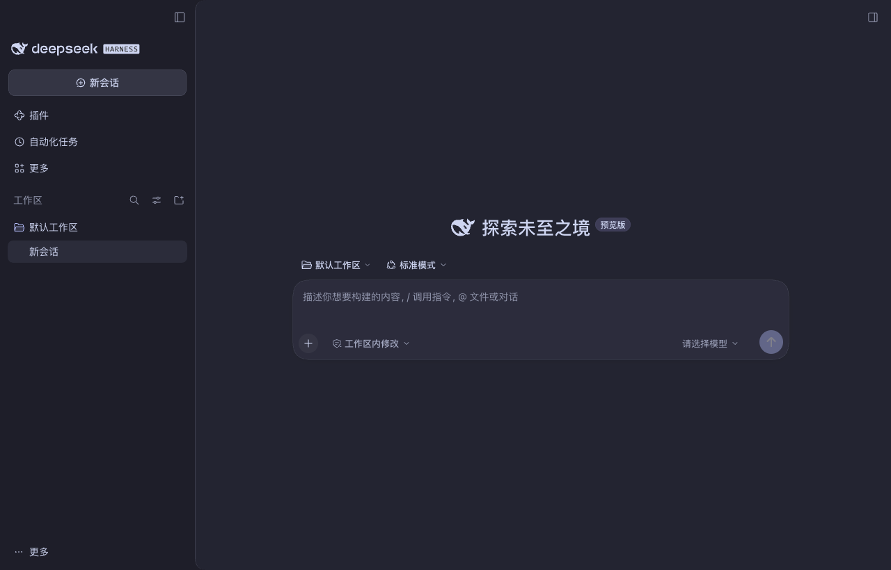

# d5v theme

给 DeepSeek Harness Desktop 和 Web 的 Catppuccin Mocha 风格主题。主内容区靠左侧栏的一边有 20 px 圆角和细描边。暗色模式从深到浅依次是侧栏、内容区、输入框，链接和主要操作用薰衣草紫。浅色模式沿用 DSH 配色，也有内容区圆角。



## 安装

已验证 DeepSeek Harness **0.2.1-rc.4** 的 macOS Desktop 和 Web。Desktop 需要先启动过一次。安装前完全退出对应的 Desktop 或 Web 实例。

```sh
dsh plugin --profile desktop add https://github.com/deadmau5v/d5v-theme/releases/download/v0.1.3/d5v-theme-0.1.3.tgz
```

Web 用户将 `desktop` 换成 `web`。在对应 profile 的 `cordis.patch.yml` 末尾追加以下配置。如果已有同名条目，保留一份即可。默认路径是 `~/.dsh/profiles/<profile>/cordis.patch.yml`，设置过 `DSH_HOME` 时以该目录为准。

```yaml
- insert:
    - id: d5v-theme
      name: d5v-theme
```

重新打开 DSH。选择「设置 → 通用 → 外观 → 深色」，或在系统处于深色模式时使用「跟随系统」。

卸载时删除上面的配置条目，随后运行 `dsh plugin --profile desktop remove d5v-theme`（Web 使用 `--profile web`）并重启。

## 自定义

[client.js](client.js) 中的 `--d5v-*` 变量集中定义配色、接缝和圆角。主题通过 DSH 客户端插件加载样式。左侧栏收起或右栏全屏时，圆角随内容区的分栏边界一起消失。

配色来自 [Catppuccin Mocha](https://github.com/catppuccin/catppuccin)。项目采用 [MIT 许可证](LICENSE)。
